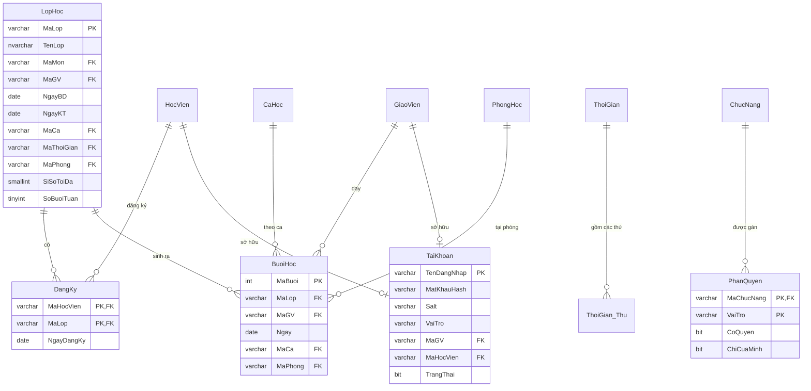
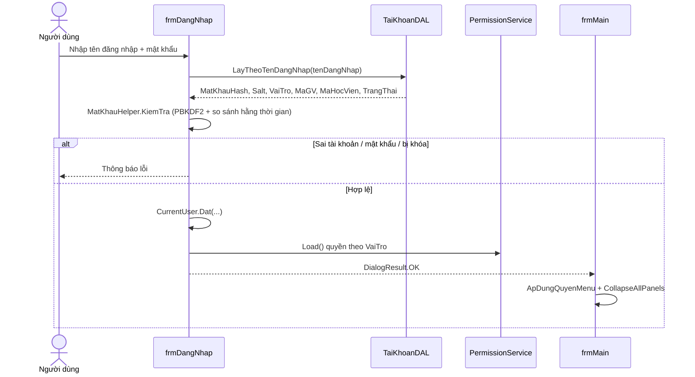
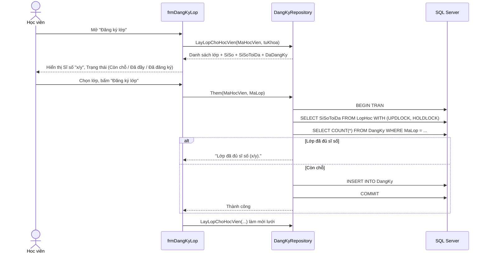

# BÁO CÁO KIẾN TRÚC VÀ LUỒNG NGHIỆP VỤ
## Hệ thống quản lý lớp tin học và ngoại ngữ ngắn hạn

> Tài liệu mô tả kiến trúc phần mềm, mô hình dữ liệu, cơ chế phân quyền và các luồng nghiệp vụ
> của ứng dụng WinForms `BTL_LTTQ`, bao gồm chức năng đăng ký lớp và xếp thời khóa biểu tự động
> bằng Google OR-Tools (CP-SAT).

---

## 1. Tổng quan

Ứng dụng là một hệ thống desktop quản lý trung tâm ngoại ngữ / tin học ngắn hạn, gồm các nhóm
chức năng chính:

| Nhóm | Chức năng |
|---|---|
| Quản lý | Lớp học, học viên, giáo viên, môn học, danh mục khác |
| Đăng ký | Học viên tự đăng ký / hủy đăng ký nhiều lớp |
| Tra cứu | Tìm lớp, tìm giáo viên, xem thời khóa biểu |
| Báo cáo | Điểm, doanh thu, xếp hạng, lớp theo phòng |
| Hệ thống | Đăng nhập, đăng ký tài khoản, phân quyền, xuất Excel |

Ba vai trò người dùng: **Admin**, **Giáo viên**, **Học viên**. Mỗi vai trò chỉ nhìn thấy
đúng dữ liệu và chức năng thuộc phạm vi của mình.

---

## 2. Công nghệ sử dụng

| Thành phần | Công nghệ |
|---|---|
| Nền tảng | .NET 10 (`net10.0-windows`), WinForms |
| Ngôn ngữ | C# (nullable reference types, implicit usings) |
| CSDL | SQL Server Express — `localhost\SQLEXPRESS` |
| Truy cập dữ liệu | `Microsoft.Data.SqlClient` 7.1.1 (ADO.NET thuần, không ORM) |
| Xếp lịch | `Google.OrTools` 9.15.6755 — bộ giải CP-SAT |
| Xuất báo cáo | Excel Interop (COM) qua `ExcelHelper` |
| Băm mật khẩu | PBKDF2-SHA256, 600.000 vòng lặp, salt 16 byte |

> **Lưu ý build:** dự án tham chiếu COM `Microsoft.Office.Interop.Excel` nên `dotnet build`
> có thể báo `MSB4803`. Dùng MSBuild của Visual Studio:
> `D:\VisualStudio\MSBuild\Current\Bin\MSBuild.exe BTL_LTTQ\BTL_LTTQ.csproj /p:Configuration=Debug`

---

## 3. Kiến trúc tổng thể

### 3.1 Sơ đồ phân lớp

```
┌──────────────────────────────────────────────────────────────────┐
│                        PRESENTATION (Forms)                      │
│  frmMain  frmDangNhap  frmLopHoc  frmMonHoc  frmDangKyLop         │
│  frmThoiKhoaBieu  frmTimKiemLopHoc  frmTimKiemGiaoVien  ...        │
│  - Hiển thị, nhập liệu, ẩn/hiện nút theo quyền                    │
│  - Không chứa SQL                                                 │
└───────────────────────────────┬──────────────────────────────────┘
                                │ gọi hàm, nhận DataTable / model
┌───────────────────────────────▼──────────────────────────────────┐
│                        BUSINESS (Services)                       │
│  LopHocService  MonHocService  LopHocTraCuuService                │
│  GiaoVienTraCuuService  LookupService  XepLichService             │
│  - Chuẩn hóa dữ liệu, kiểm tra nghiệp vụ, gom lỗi cho UI          │
│  - XepLichService: dựng mô hình CP-SAT và điều phối lưu lịch      │
└───────────────────────────────┬──────────────────────────────────┘
                                │
┌───────────────────────────────▼──────────────────────────────────┐
│                      DATA ACCESS (Repositories)                  │
│  LopHocRepository  MonHocRepository  DangKyRepository             │
│  ThoiKhoaBieuRepository  LopHocTraCuuRepository  ...              │
│  - Câu lệnh SQL tham số hóa                                       │
│  - Áp phạm vi dữ liệu (PhamViDuLieu)                              │
│  - Chặn thao tác trái quyền (PermissionService.YeuCau)             │
└───────────────────────────────┬──────────────────────────────────┘
                                │
┌───────────────────────────────▼──────────────────────────────────┐
│                    DATA ACCESS LAYER (DbHelper)                  │
│  DbHelper.ExecuteQuery / ExecuteNonQuery / ExecuteScalar /        │
│  ExecuteTransaction                                              │
│  TaiKhoanDAL, PhanQuyenDAL                                        │
└───────────────────────────────┬──────────────────────────────────┘
                                │ ADO.NET
┌───────────────────────────────▼──────────────────────────────────┐
│                     SQL SERVER EXPRESS                           │
│  QuanLyLopTinHocVaNgoaiNguNganHan                                │
└──────────────────────────────────────────────────────────────────┘
```

### 3.2 Các thành phần dùng chung (`Common/`)

| Thành phần | Vai trò |
|---|---|
| `CurrentUser` | Lưu tên đăng nhập, vai trò, `MaGV`, `MaHocVien` của phiên hiện tại |
| `PermissionService` | Cache quyền theo vai trò; `Can()`, `ChiCuaMinh()`, `YeuCau()` |
| `PhamViDuLieu` | Sinh điều kiện SQL lọc dữ liệu theo vai trò |
| `PhanQuyenUi` | Ẩn nút / chặn mở form theo mã chức năng |
| `ChucNangConst` | Hằng số mã chức năng (tránh gõ chuỗi sai) |
| `VaiTroConst` | Hằng số vai trò `Admin`, `GiaoVien`, `HocVien` |
| `MatKhauHelper` | Tạo salt, băm và kiểm tra mật khẩu PBKDF2 |
| `ExcelHelper` | Xuất `DataGridView` đang hiển thị ra file Excel |
| `GiaoDien` | Bảng màu, style control, đánh dấu mục menu đang chọn |

### 3.3 Cấu trúc thư mục

```
BTL_LTTQ/
├── Common/            # Tiện ích dùng chung (quyền, phiên, giao diện, Excel)
├── DataAccessLayer/   # DbHelper + DAL tài khoản / phân quyền
├── Models/            # Lớp thực thể: LopHoc, MonHoc, BuoiHoc, DangKy, ...
├── Repositories/      # SQL theo từng thực thể
├── Services/          # Nghiệp vụ + bộ xếp lịch CP-SAT
├── Forms/
│   ├── HeThong/       # Đăng nhập, đăng ký, phân quyền
│   ├── QuanLy/        # Lớp học, môn học, đăng ký lớp
│   ├── TraCuu/        # Tìm lớp, tìm giáo viên, thời khóa biểu
│   └── frmMain.*      # Form chính + menu điều hướng
├── Database/          # Script SQL (PhanQuyen.sql, ThoiKhoaBieu.sql)
└── Program.cs         # Điểm khởi động: đăng nhập → mở frmMain
```

---

## 4. Mô hình dữ liệu

### 4.1 Bảng gốc (giữ nguyên)

`LopHoc`, `HocVien`, `GiaoVien`, `MonHoc`, `PhongHoc`, `CaHoc`, `ThoiGian`,
`NgheNghiep`, `TrinhDo`, `XepLoai`, `ChucDanh`, `ChuyenMon`, `CoQuan`,
`GiaoVien_MonHoc`.

### 4.2 Thành phần bổ sung (chỉ THÊM, không xóa/đổi tên)

**Cột thêm vào bảng cũ**

| Bảng | Cột | Kiểu | Ý nghĩa |
|---|---|---|---|
| `LopHoc` | `SiSoToiDa` | `smallint NOT NULL` (mặc định 30) | Giới hạn đăng ký |
| `LopHoc` | `SoBuoiTuan` | `tinyint NOT NULL` (mặc định 3) | Số buổi mỗi tuần khi xếp lịch |
| `PhongHoc` | `SucChua` | `smallint NULL` | Sức chứa để solver chọn phòng |
| `CaHoc` | `GioBatDau` | `time(0) NULL` | Giờ bắt đầu ca |
| `CaHoc` | `GioKetThuc` | `time(0) NULL` | Giờ kết thúc ca |

> `LopHoc.SiSo` là cột cũ, **không còn dùng** để tính sĩ số thực tế. Sĩ số hiện tại được đếm
> từ bảng `DangKy` (học viên có thể học nhiều lớp).

**Bảng mới**

| Bảng | Khóa | Cột chính | Ý nghĩa |
|---|---|---|---|
| `ChucNang` | `MaChucNang` | `TenChucNang`, `Nhom`, `ChiAdmin`, `HoTroLocTheoChu`, `ThuTu` | Danh mục quyền |
| `PhanQuyen` | `(MaChucNang, VaiTro)` | `CoQuyen`, `ChiCuaMinh` | Quyền mặc định theo vai trò |
| `TaiKhoan` | `TenDangNhap` | `MatKhauHash`, `Salt`, `VaiTro`, `MaGV`, `MaHocVien`, `TrangThai` | Tài khoản đăng nhập |
| `ThoiGian_Thu` | `(MaThoiGian, Thu)` | `Thu` 2..8 (8 = Chủ nhật) | Chuẩn hóa thứ trong tuần sang số |
| `DangKy` | `(MaHocVien, MaLop)` | `NgayDangKy` | Quan hệ nhiều-nhiều học viên – lớp |
| `BuoiHoc` | `MaBuoi` (identity) | `MaLop`, `MaGV`, `Ngay`, `MaCa`, `MaPhong` | Kết quả xếp thời khóa biểu |

**Ràng buộc toàn vẹn quan trọng**

- `UX_TaiKhoan_MaGV`, `UX_TaiKhoan_MaHocVien`, `UX_TaiKhoan_Admin`: mỗi hồ sơ chỉ một tài khoản.
- `CK_TaiKhoan_HoSo`: Admin không gắn hồ sơ; Giáo viên chỉ gắn `MaGV`; Học viên chỉ gắn `MaHocVien`.
- `CK_PhanQuyen_ChiCuaMinh`: `ChiCuaMinh = 1` chỉ khi `CoQuyen = 1`.
- `UX_BuoiHoc_Phong (Ngay, MaCa, MaPhong)`: một phòng chỉ một lớp trong cùng ngày + ca.
- `UX_BuoiHoc_GiaoVien (Ngay, MaCa, MaGV)`: một giáo viên chỉ dạy một lớp trong cùng ngày + ca.
- `IX_BuoiHoc_Lop (MaLop, Ngay)`: tăng tốc truy vấn thời khóa biểu theo lớp.

### 4.3 Sơ đồ quan hệ (ERD)



---

## 5. Thiết kế phân quyền

### 5.1 Mô hình hai lớp

Hệ thống dùng RBAC kết hợp phạm vi dữ liệu:

1. **Quyền chức năng** (`CoQuyen`): vai trò có được thực hiện hành động hay không.
2. **Phạm vi dữ liệu** (`ChiCuaMinh`): nếu bật, vai trò chỉ thao tác trên dữ liệu của chính mình.

Admin được đặc cách: `PermissionService.Can()` luôn trả `true`, `ChiCuaMinh()` luôn trả `false`
(nghĩa là thấy toàn bộ dữ liệu). Hai chức năng `PHANQUYEN` và `TAIKHOAN` bị chặn cứng với
mọi vai trò không phải Admin.

### 5.2 Ba lớp kiểm tra

```
Người dùng bấm nút
      │
      ▼
[1] Giao diện  ──  PhanQuyenUi.AnNeuKhongCoQuyen / OpenChildForm
      │            Ẩn nút, chặn mở form, báo "Không có quyền"
      ▼
[2] Service / Repository  ──  PermissionService.YeuCau(...)
      │            Ném UnauthorizedAccessException nếu bị gọi tắt
      ▼
[3] SQL  ──  PhamViDuLieu.ChoLopHoc / ChoHocVien
                   Thêm điều kiện WHERE theo MaGV / MaHocVien / DangKy
```

Lớp 2 và 3 là "phòng thủ chiều sâu": dù một form bị gọi trực tiếp hoặc một nút bị lộ,
tầng dữ liệu vẫn từ chối thao tác và không trả về dữ liệu ngoài phạm vi.

### 5.3 Ma trận quyền mặc định

Ký hiệu: `✓` = có quyền, `–` = không có quyền, `✓*` = có quyền nhưng chỉ dữ liệu của mình.

| Mã chức năng | Tên | Giáo viên | Học viên |
|---|---|:---:|:---:|
| `LOPHOC_XEM` | Xem lớp học | ✓* | ✓* |
| `LOPHOC_THEM` | Thêm lớp học | – | – |
| `LOPHOC_SUA` | Sửa lớp học | ✓* | – |
| `LOPHOC_XOA` | Xóa lớp học | – | – |
| `HOCVIEN_XEM` | Xem học viên | ✓* | ✓* |
| `HOCVIEN_THEM/SUA/XOA` | Quản lý học viên | – | – |
| `GIAOVIEN_XEM` | Xem giáo viên | – | – |
| `GIAOVIEN_THEM/SUA/XOA` | Quản lý giáo viên | – | – |
| `MONHOC_XEM` | Xem môn học | ✓ | ✓ |
| `MONHOC_THEM/SUA/XOA` | Quản lý môn học | – | – |
| `TIM_LOP` | Tra cứu lớp | ✓* | ✓* |
| `TIM_GIAOVIEN` | Tra cứu giáo viên | ✓ | – |
| `BC_DIEM` | Báo cáo điểm | ✓* | ✓* |
| `BC_DOANHTHU`, `BC_XEPHANG`, `BC_LOP_PHONG` | Báo cáo khác | – | – |
| `DANHMUC_KHAC` | Danh mục khác | – | – |
| `XUAT_EXCEL` | Xuất Excel | ✓ | ✓ |
| `DANGKYLOP` | Đăng ký lớp | – | ✓* |
| `THOIKHOA_XEM` | Xem thời khóa biểu | ✓* | ✓* |
| `PHANQUYEN` | Phân quyền | – | – |
| `TAIKHOAN` | Quản lý tài khoản | – | – |
| `THOIKHOA_XEP` | Tạo thời khóa biểu | – | – |

> `PHANQUYEN`, `TAIKHOAN`, `THOIKHOA_XEP` chỉ Admin dùng được (không có dòng trong `PhanQuyen`).

### 5.4 Phạm vi dữ liệu (`PhamViDuLieu`)

| Vai trò | Lớp học | Học viên |
|---|---|---|
| Admin | Toàn bộ | Toàn bộ |
| Giáo viên | `LopHoc.MaGV = @MaGV` | Học viên thuộc lớp mình dạy |
| Học viên | `EXISTS (SELECT 1 FROM DangKy ...)` | `HocVien.MaHocVien = @MaHocVien` |
| Không có quyền | `1 = 0` | `1 = 0` |

`PhamViDuLieu` nay kiểm tra `Can()` **trước** `ChiCuaMinh()`. Nếu vai trò không có quyền xem,
điều kiện trả về là `1 = 0` thay vì điều kiện rỗng — tránh trường hợp repository trả toàn bộ
dữ liệu khi quyền chưa được nạp hoặc bị thu hồi.

### 5.5 Guard ở tầng repository

Ngoài kiểm tra trên giao diện, các thao tác ghi được chặn ngay tại repository:

| Repository | Hàm | Mã quyền yêu cầu |
|---|---|---|
| `LopHocRepository` | `Them` | `LOPHOC_THEM` (+ chặn Học viên) |
| `LopHocRepository` | `Sua` | `LOPHOC_SUA` (+ chặn Học viên, giới hạn theo phạm vi) |
| `LopHocRepository` | `Xoa` | `LOPHOC_XOA` (+ chặn Học viên) |
| `MonHocRepository` | `LayDanhSach` | `MONHOC_XEM` (trả bảng rỗng nếu không có quyền) |
| `MonHocRepository` | `Them` | `MONHOC_THEM` |
| `MonHocRepository` | `Sua` | `MONHOC_SUA` |
| `MonHocRepository` | `Xoa` | `MONHOC_XOA` |
| `XepLichService` | `XepVaLuu` | `THOIKHOA_XEP` |
| `DangKyRepository` | `Them` / `Huy` | `DANGKYLOP` (kiểm tra ở form) |

Cơ chế: `PermissionService.YeuCau(maChucNang, thongBao)` ném `UnauthorizedAccessException`.
Các service bắt lại và trả chuỗi lỗi thân thiện để form hiển thị bằng `MessageBox`.

---

## 6. Luồng nghiệp vụ

### 6.1 Đăng nhập



- Không có chức năng "Đăng xuất": muốn đổi vai trò phải tắt và mở lại ứng dụng.
- Nếu nạp quyền thất bại, hệ thống xóa phiên và từ chối đăng nhập (fail-closed).

### 6.2 Admin tạo lớp

1. Admin mở **Quản lý → Lớp học**.
2. Nhập: mã lớp, tên lớp, môn, giáo viên, ngày bắt đầu/kết thúc, ca, thời gian, phòng.
3. Nhập thêm **Sĩ số tối đa** (1..500) và **Số buổi/tuần** (1..7).
4. `LopHocService` chuẩn hóa và kiểm tra:
   - Mã/tên lớp không rỗng.
   - Đã chọn đủ môn, giáo viên, ca, thời gian, phòng.
   - `NgayKT >= NgayBD`.
   - `SiSoToiDa >= 1`, `1 <= SoBuoiTuan <= 7`.
   - Mã lớp chưa tồn tại.
5. `LopHocRepository.Them` kiểm tra quyền `LOPHOC_THEM` rồi `INSERT`.

`MaCa`, `MaPhong`, `MaThoiGian` ở bước này đóng vai trò **ưu tiên mềm** cho bộ xếp lịch,
không phải lịch cố định.

### 6.3 Học viên đăng ký nhiều lớp



Quy tắc nghiệp vụ:

- Một học viên đăng ký **nhiều lớp** (bảng `DangKy` nhiều-nhiều).
- Không đăng ký trùng: khóa chính `(MaHocVien, MaLop)` + bắt lỗi 2627/2601.
- Chặn vượt sĩ số: khóa dòng `LopHoc` bằng `UPDLOCK, HOLDLOCK` trong transaction để tránh
  hai người đăng ký đồng thời vượt giới hạn.
- Học viên có thể hủy đăng ký; hệ thống báo nếu chưa đăng ký lớp đó.
- Chức năng này **chỉ dành cho Học viên**; nút menu bị ẩn với Admin và Giáo viên.

### 6.4 Admin tạo thời khóa biểu

1. Admin mở **Tra cứu → Thời khóa biểu**.
2. Nút **"Tạo thời khóa biểu"** chỉ hiển thị khi có quyền `THOIKHOA_XEP`.
3. Nếu đã có lịch, hệ thống hỏi xác nhận thay thế.
4. `XepLichService.XepVaLuu()`:
   - Đọc dữ liệu đầu vào từ `ThoiKhoaBieuRepository`.
   - Chỉ xếp các lớp có ít nhất 1 học viên đăng ký; lớp rỗng bị bỏ qua và báo lại.
   - Dựng mô hình CP-SAT, giải trong tối đa 20 giây.
   - Sinh ngày thực trong `NgayBD..NgayKT`, ghi đè toàn bộ `BuoiHoc` trong một transaction.
5. Kết quả hiển thị ngay, **không có bước công bố**.
6. Giáo viên / Học viên mở cùng form và chỉ thấy lịch của mình.

### 6.5 Giáo viên / Học viên xem thời khóa biểu

- `frmThoiKhoaBieu` xác định phạm vi theo `CurrentUser`:
  - Giáo viên → `_maGV = CurrentUser.MaGV`.
  - Học viên → `_maHocVien = CurrentUser.MaHocVien`.
  - Admin → cả hai `null` (xem tất cả).
- `ThoiKhoaBieuRepository.LayLich` lọc:
  - `(@MaGV IS NULL OR b.MaGV = @MaGV)`
  - `(@MaHocVien IS NULL OR EXISTS (SELECT 1 FROM DangKy ...))`
- Giao diện gồm 2 tab:
  - **Lịch nhiều tuần**: bảng `Tuần / Ca / Thứ 2..Chủ nhật` hiển thị liên tiếp nhiều tuần
    (mặc định 4 tuần, chọn 1..12). Mỗi tuần là một khối dòng theo từng ca; ô hiển thị
    mã lớp, tên môn, phòng và ngày cụ thể. Tuần luôn bắt đầu từ **Thứ 2**.
  - **Chi tiết buổi học**: ngày, thứ, ca, giờ, mã lớp, tên lớp, môn, giáo viên, phòng.
- Điều hướng lịch:
  - `MonthCalendar` nhỏ (lịch tháng) cho phép bấm trực tiếp một ngày; lưới tự nhảy về tuần chứa ngày đó.
  - Nút **◀ Tuần trước / Tuần này / Tuần sau ▶** dịch khoảng xem theo tuần.
  - Ô **Số tuần hiển thị** (1..12, mặc định 4) đổi số tuần vẽ trên lưới.
  - Nhãn `Đang xem: dd/MM/yyyy - dd/MM/yyyy` + số buổi học trong khoảng đang xem.
- Khi mở form, hệ thống nhảy về tuần hiện tại (nếu lịch bao quanh hôm nay) hoặc tuần của buổi học
  gần nhất; sau khi xếp lịch thành công thì nhảy về tuần có buổi học sớm nhất để thấy ngay lịch mới.
- Tab chi tiết là nguồn dữ liệu cho nút **Xuất Excel** (lưới nhiều tuần chỉ để xem).

### 6.6 Xuất Excel

- `frmMain` theo dõi form con đang mở; nút Xuất Excel bật khi:
  - Có quyền `XUAT_EXCEL`, và
  - Lưới hiện tại có ít nhất một dòng dữ liệu.
- Form muốn xuất khai báo `IXuatExcel` (`LuoiXuat`, `TieuDeXuat`).
- `ExcelHelper.XuatTrangHienTai` tạo workbook, ghi tiêu đề và dữ liệu, mở bằng Excel.

---

## 7. Thuật toán xếp thời khóa biểu (CP-SAT)

### 7.1 Bài toán

Xếp lịch theo **tuần mẫu**: 7 thứ × *n* ca × *m* phòng, sau đó nhân bản ra các ngày thực tế
trong khoảng `NgayBD..NgayKT` của từng lớp.

**Đầu vào** (`DuLieuXepLich`)

| Thành phần | Nội dung |
|---|---|
| `Lop` | Mã lớp, giáo viên, sĩ số, `SoBuoiTuan`, `NgayBD/KT`, thứ ưu tiên, ca ưu tiên, phòng ưu tiên, danh sách học viên |
| `Ca` | Danh sách mã ca, sắp theo giờ bắt đầu |
| `Phong` | Danh sách phòng + sức chứa |

**Đầu ra**: danh sách `BuoiHoc` (lớp, giáo viên, ngày, ca, phòng) + thông báo tổng kết.

### 7.2 Biến quyết định

Với mỗi bộ `(lớp c, buổi s, thứ d, ca k, phòng r)` mà phòng đủ sức chứa:

```
x[c, s, d, k, r] ∈ {0, 1}
```

`x = 1` nghĩa là buổi thứ `s` của lớp `c` diễn ra vào thứ `d`, ca `k`, tại phòng `r`.
Biến chỉ được tạo khi `SucChua(phòng) >= SiSo(lớp)`, giúp giảm mạnh không gian tìm kiếm.

### 7.3 Ràng buộc cứng

| # | Ràng buộc | Diễn giải |
|---|---|---|
| C1 | `Σ x[c,s,·,·,·] = 1` | Mỗi buổi được xếp đúng một chỗ |
| C2 | `Σ x[·,·,d,k,r] <= 1` | Một phòng chỉ một lớp trong cùng (thứ, ca) |
| C3 | `Σ x[·,·,d,k,·] <= 1` theo giáo viên | Một giáo viên chỉ dạy một lớp trong cùng (thứ, ca) |
| C4 | `Σ x[c,·,d,·,·] <= 1` | Một lớp không học 2 buổi trong cùng ngày |
| C5 | `Σ x[c∈HV,·,d,k,·] <= 1` | Một học viên không ở 2 lớp trong cùng (thứ, ca) |
| C6 | `SucChua(r) >= SiSo(c)` | Phòng phải đủ chỗ (áp ngay khi tạo biến) |

Ngoài ra solver còn kiểm tra trước: lớp phải có học viên, có ca học, có phòng, `SoBuoiTuan`
trong 1..7, `NgayKT >= NgayBD`, lớp đã gán giáo viên.

### 7.4 Ràng buộc mềm (hàm mục tiêu)

Mỗi vi phạm cộng thêm chi phí; solver tối thiểu hóa tổng chi phí:

| Vi phạm | Trọng số |
|---|---:|
| Lệch thứ ưu tiên (không nằm trong mẫu `ThoiGian_Thu`) | 4 |
| Lệch ca ưu tiên | 3 |
| Lệch phòng ưu tiên | 1 |
| Học ca muộn (ca có chỉ số càng lớn càng bị phạt) | 1 mỗi bậc |
| Hai buổi liền ngày (d và d+1) | 10 |

Ràng buộc "2 buổi liền ngày" là mềm: với `SoBuoiTuan` lớn (5–7) solver vẫn có thể tìm được
lịch, chỉ chịu phạt thay vì báo lỗi.

### 7.5 Giải và sinh ngày thực

```csharp
var solver = new CpSolver();
solver.StringParameters = "max_time_in_seconds:20.0 num_search_workers:4 random_seed:42";
CpSolverStatus trangThai = solver.Solve(model);
```

- Chấp nhận `Optimal` hoặc `Feasible`.
- Với mỗi biến `x = 1`, duyệt các ngày trong `NgayBD..NgayKT`, giữ ngày có thứ trùng với
  `d` (0 = Thứ 2 … 6 = Chủ nhật) và tạo một dòng `BuoiHoc`.
- Nếu không sinh được buổi nào (khoảng ngày quá ngắn), trả lỗi rõ ràng.
- Ghi đè `BuoiHoc` trong một transaction: `DELETE` toàn bộ → `INSERT` lần lượt.

### 7.6 Ví dụ kết quả thực tế

Với dữ liệu mẫu hiện tại (L01: 5 học viên; L02: 5 học viên; L003: 0 học viên):

| Lớp | Ca | Phòng | Các thứ | Số buổi |
|---|---|---|---|---|
| L01 | CA03 | PH01 | Thứ 3 – 5 – 7 | 25 |
| L02 | CA01 | PH03 | Thứ 2 – 4 – 6 | 26 |

L003 bị bỏ qua vì chưa có học viên đăng ký. Kết quả khớp với ưu tiên mềm đã khai báo
(`L01` ưu tiên TG02 = 3-5-7, `L02` ưu tiên TG01 = 2-4-6).

---

## 8. Bảo mật và toàn vẹn dữ liệu

| Khía cạnh | Cách xử lý |
|---|---|
| Mật khẩu | PBKDF2-SHA256, 600.000 vòng, salt ngẫu nhiên 16 byte, so sánh hằng thời gian |
| SQL Injection | Toàn bộ truy vấn dùng `SqlParameter`, không nối chuỗi dữ liệu người dùng |
| Phân quyền | Ba lớp: UI → Service/Repository → SQL scope; fail-closed khi thiếu quyền |
| Đăng ký đồng thời | `UPDLOCK, HOLDLOCK` trên dòng `LopHoc` + transaction |
| Xếp lịch | Ghi đè trong một transaction, unique index chặn trùng phòng/giáo viên |
| Tài khoản | Ràng buộc CHECK đảm bảo mỗi vai trò gắn đúng loại hồ sơ |
| Khóa tài khoản | Cột `TrangThai`; tài khoản bị khóa không đăng nhập được |

---

## 9. Kiểm thử

Bộ kiểm thử tự động (smoke test) chạy ngoài solution, tham chiếu `BTL_LTTQ.dll`, gồm **81 trường hợp**:

| Nhóm | Nội dung |
|---|---|
| 1. Đăng nhập | Đúng/sai mật khẩu, tài khoản không tồn tại, vai trò, quyền Admin/GV |
| 2. Phạm vi dữ liệu | GV chỉ thấy lớp của mình; HV chỉ thấy lớp đã đăng ký |
| 3. Đăng ký lớp | Đăng ký nhiều lớp, chặn trùng, chặn vượt sĩ số, dọn dữ liệu test |
| 4. Xếp lịch | Tạo lịch thành công, không trùng phòng/GV, không 2 buổi/ngày, phòng đủ chỗ, bỏ qua lớp rỗng |
| 5. Xem TKB | HV/GV chỉ thấy lịch của mình, không trùng (ngày, ca) |
| 6. Khởi tạo form | `frmDangKyLop`, `frmThoiKhoaBieu`, `frmLopHoc`, `frmMain` mở không lỗi; lưới nhiều tuần đủ 9 cột, có lịch nhỏ, đổi tuần/đổi số tuần/chọn ngày đều vẽ lại đúng |
| 7. Menu theo vai trò | HV thấy nút Đăng ký lớp, Admin không thấy |
| 8. Guard repository | GV bị chặn thêm/xóa lớp, thêm/sửa/xóa môn; không quyền xem thì không lộ dữ liệu; Admin thao tác thành công |

Kết quả lần chạy gần nhất: **81/81 PASS**.

Lệnh chạy lại script CSDL:

```powershell
sqlcmd -S "localhost\SQLEXPRESS" -d "QuanLyLopTinHocVaNgoaiNguNganHan" `
       -E -C -f 65001 -b -i Database\PhanQuyen.sql
sqlcmd -S "localhost\SQLEXPRESS" -d "QuanLyLopTinHocVaNgoaiNguNganHan" `
       -E -C -f 65001 -b -i Database\ThoiKhoaBieu.sql
```

---

## 10. Hạn chế và hướng phát triển

| Hạn chế hiện tại | Hướng khắc phục |
|---|---|
| Chưa có Đăng xuất; đổi vai trò phải tắt app | Thêm nút Đăng xuất, gọi `CurrentUser.Xoa()` + mở lại `frmDangNhap` |
| Chưa có màn hình quản lý tài khoản | Dùng chức năng `TAIKHOAN` đã seed sẵn |
| Chưa có UI quản lý ca học / phòng học / sức chứa | Bổ sung form danh mục hoặc dùng `DanhMucKhac` |
| Xếp lịch chạy đồng bộ trên UI thread | Chạy nền (`Task.Run`) + thanh tiến trình |
| Lưới nhiều tuần hiển thị đủ mọi ca của toàn bộ lịch, kể cả tuần không có buổi | Lọc ca theo khoảng đang xem để lưới gọn hơn |
| Lịch tháng chưa đánh dấu ngày có buổi học | Dùng `BoldedDates` + `MonthlyBoldedDates` để tô đậm các ngày có lịch |
| `LopHoc.SiSo` cũ chưa được đồng bộ | Có thể xóa khi chắc chắn không còn báo cáo cũ dùng tới |
| Chưa ghi log thao tác | Thêm bảng `NhatKyThaoTac` + ghi ở service |
| Excel Interop yêu cầu cài Office | Chuyển sang `ClosedXML` / `EPPlus` nếu cần chạy không Office |
| Smoke test nằm ngoài repo | Đưa vào project test chính thức (xUnit/NUnit) |

---

## 11. Phụ lục

### 11.1 Tài khoản mẫu

| Tên đăng nhập | Mật khẩu | Vai trò | Hồ sơ |
|---|---|---|---|
| `admin` | `Admin@123` | Admin | — |
| `gv01` | `Demo@123` | Giáo viên | `GV01` |
| `hv01` | `Demo@123` | Học viên | `HV01` |

### 11.2 Dữ liệu mẫu

| Lớp | Giáo viên | Ca | Phòng | Thời gian | Sĩ số |
|---|---|---|---|---|---|
| `L01` | `GV01` | `CA03` | `PH01` | `TG02` (3-5-7) | 5/30 |
| `L02` | `GV02` | `CA01` | `PH03` | `TG01` (2-4-6) | 5/30 |
| `L003` | — | — | — | — | 0/30 |

### 11.3 Quy ước thứ trong tuần

| Giá trị lưu CSDL | Ý nghĩa | Chỉ số C# (0..6) |
|---|---|---|
| 2 | Thứ 2 | 0 |
| 3 | Thứ 3 | 1 |
| 4 | Thứ 4 | 2 |
| 5 | Thứ 5 | 3 |
| 6 | Thứ 6 | 4 |
| 7 | Thứ 7 | 5 |
| 8 | Chủ nhật | 6 |

---

*Tài liệu được lập ngày 13/11/2026, phản ánh trạng thái mã nguồn hiện tại (chưa commit).*
